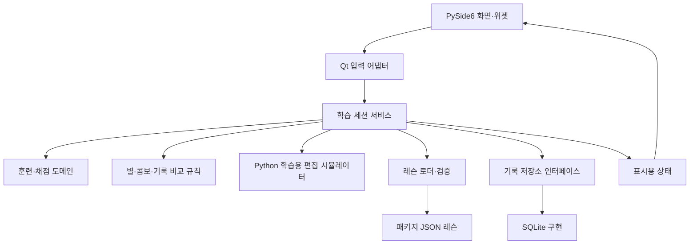

# vim-key-trainer 소프트웨어 설계

작성일: 2026-11-06  
상태: 메뉴와 숫자·기호 연습의 첫 흐름 구현. 전체 MVP의 설계와 후속 범위를 함께 기록한다.

2026-11-07 현재 `QMainWindow`·`QStackedWidget` 메뉴, 설정, 키 입력 진단과 숫자·Shift 기호·기타 기호·혼합의 4종 무작위 연습을 제공한다. 기본 20자를 동시에 표시하고 총 100자를 입력해 결과를 확인한다. 표시량 10/20/40자, 총 목표 20/50/100/200자, 글꼴 크기를 조절할 수 있다. 오타 위치 유지, 일시정지·포커스 상실 시간 제외, 콤보·별·메모리 개인 기록, 같은 문제 재도전과 새 문제 생성을 구현했다. 명령 연습·편집 엔진·JSON 레슨 로더·영구 저장·효과음·애니메이션은 아직 구현하지 않았다. 실제 OS 키보드·IME 수동 검증과 자동 Qt 검증은 구분하며 완료 상태는 [todo.md](todo.md)를 따른다.

## 1. 제품 정의

**Python 데스크톱 GUI 기반의 Vim 타자·편집 학습 게임 `vim-key-trainer`**를 만든다. 숫자·기호를 연속 타이핑하고, 여러 의미 있는 Vim 명령을 보며 입력한 다음, 수정 전·후 문서를 비교하며 짧고 빠르게 목표 문서를 만드는 게임이다. 마지막 단계는 가이드를 따르거나 스스로 풀 수 있으며 결과 화면에서 기준 풀이 대비 입력 횟수 차이와 수정 시간을 보여 준다. 레슨 완주, 별 획득, 콤보, 소리·화면 효과와 개인 기록 갱신으로 재도전을 유도한다.

제품 표시 이름·배포 이름·콘솔 실행 명령은 `vim-key-trainer`, Python import와 모듈 실행 이름은 `vim_key_trainer`로 사용한다.

### 실행 방식과 제품 경계

앱 전체는 Python 프로세스와 PySide6 창으로 구성한다. Vim 키는 학습 대상이고, 패키지 레슨의 연습 문서는 Python으로 작성한 **학습용 편집 시뮬레이터**가 메모리에서 관리한다. 실제 Vim/Neovim 실행 파일 호출, 터미널 임베딩, RPC 연동을 사용하지 않는다. 사용자의 편집기 설치·설정과 무관하게 실행하며, 레슨 검증도 내부 시뮬레이터에 토큰을 재생해 수행한다.

1·2단계는 목표 토큰과 입력을 비교하는 타자·명령 암기 게임이다. 3단계에서만 내부 시뮬레이터가 지원 명령을 해석해 연습 문서를 바꾼다. Vim 공식 도움말은 동작을 확인하는 설계 자료이며 실행 의존성이 아니다.

| 단계 | 연습 대상 | 화면의 핵심 요소 | 주된 평가 |
| --- | --- | --- | --- |
| 1. 숫자·기호 | 상단 숫자열, Shift 숫자 기호, 기타 기호 | 10~20자 이상을 동시에 표시하는 연속 문자열, 현재 입력 위치 | 정확도, CPM, 최대 콤보 |
| 2. Vim 명령 | `8ciw`, `22gg`, `qa`, `"+y` 등 의미 있는 시퀀스 | 여러 명령 동시 나열, 활성 명령 강조, 하단의 현재 명령 의미 | 시퀀스 정확도, 명령 완료 수·시간 |
| 3. 문서 수정 | 가이드 풀이와 자유 풀이 | 왼쪽 수정 중 문서, 오른쪽 고정 목표 문서, 하단 가이드·입력 횟수·시간 | 문서 일치, 기준 대비 입력 횟수 차이, 수정 시간 |

### 기본 가정

- UI는 한국어를 기본으로 하며 연습용 명령·문서는 ASCII 영문을 사용한다.
- Python 3.12를 최초 검증 기준으로 삼는다. 추가 Python 버전 지원은 CI 검증 후 선언한다.
- GUI는 PySide6 + Qt Widgets로 구현한다. 실행 시 독립된 창을 띄운다.
- macOS를 우선 검증하고 Windows·Linux를 순차 검증한다. 운영체제별 확인 상태를 기록한다.
- 화면 키보드는 US QWERTY를 기준으로 한다. 다른 배열에서는 안내와 실제 기호 위치가 다를 수 있다.
- 설치 후 기본 학습은 로컬에서 동작한다. 계정, 서버, 네트워크, Vim 설치를 요구하지 않는다.

### MVP 범위

세 단계의 학습, 연속 문자열·명령 목록, 가이드·자유 편집 과제, 기준 풀이 대비 입력 횟수와 시간, 레슨별 별, 콤보, 소리·화면 효과, 개인 최고 기록, 로컬 기록, 간단한 오답 복습을 포함한다. 편집 연습은 지원 명령이 명시된 Python 시뮬레이터를 사용한다. 제한 시간 도전, 업적·경험치·레벨, Unicode 연습 문서는 후속 범위다. 실제 Vim 전체 호환, 사용자 파일 편집, 웹 서비스·클라우드 동기화는 현재 제품 범위에 포함하지 않는다.

## 2. 3rd party 라이브러리와 도구

### 실행 의존성

| 라이브러리 | 선택 용도 | 적용 원칙 |
| --- | --- | --- |
| [PySide6](https://doc.qt.io/qtforpython-6/gettingstarted.html) | Qt Widgets 기반 창, 입력 이벤트, 문서 표시, 화면 키보드 | GUI의 기본 프레임워크. Qt 6 계열을 사용한다. |
| [Pydantic](https://docs.pydantic.dev/latest/concepts/models/) | JSON 레슨·설정의 구조와 값 검증 | v2 API 기준. 외부 데이터 경계에 사용하고 엔진 내부는 dataclass 등으로 단순하게 유지한다. |
| [platformdirs](https://platformdirs.readthedocs.io/en/latest/) | OS에 맞는 설정·학습 기록 경로 | 현재 디렉터리에 개인 기록을 저장하지 않는다. |

PySide6를 선택한 이유는 데스크톱 위젯, 키 이벤트, 문서 표시를 한 프레임워크 안에서 구성하기 위해서다. QML과 웹 프런트엔드는 초기 구성에 포함하지 않는다. 화면 키보드와 간단한 통계는 Qt 위젯·페인팅으로 그린다.

### 게임 요소에 대한 적합성

| 기능 | 구현 수단 | 별도 실행 의존성 |
| --- | --- | --- |
| 별·콤보·레슨 진행·기록 갱신 표시 | Qt Widgets, `QPainter`, 순수 Python 보상 규칙 | 없음 |
| 정답 강조·완주 연출 | [QPropertyAnimation](https://doc.qt.io/qtforpython-6/PySide6/QtCore/QPropertyAnimation.html), 화면 갱신용 [QTimer](https://doc.qt.io/qtforpython-6/PySide6/QtCore/QTimer.html) | 없음 |
| 정답·오타·명령 완료·과제 성공 효과음 | [QSoundEffect](https://doc.qt.io/qtforpython-6/PySide6/QtMultimedia/QSoundEffect.html), 패키지 내 짧은 WAV | 없음. PySide6의 QtMultimedia 사용 |
| 별·개인 기록의 재실행 후 유지 | 표준 `sqlite3`, `platformdirs` | 기존 의존성으로 충분 |

이 범위는 입력 중심의 학습 게임이므로 `pygame`·`arcade`를 추가하지 않는다. 별도 렌더링 루프와 Qt 이벤트 루프를 함께 운영할 필요가 없다. 실시간 액션·물리 시뮬레이션·대규모 스프라이트가 제품 요구가 되면 렌더러를 다시 검토한다. 기본 `PySide6` 배포에는 이 앱이 쓰지 않는 모듈도 포함될 수 있으므로 설치 크기는 M0·배포 단계에서 확인한다. 모듈 분리 설치는 실제 사용 범위와 패키징 검증 후 결정한다.

소리·화면 효과는 MVP에서 구현하고 설정에서 각각 켜고 끌 수 있게 한다. 초기 기본값은 소리 끄기, 짧은 시각 강조 켜기이며 음량·모션 줄이기 설정을 제공한다. 소리·애니메이션을 꺼도 정오답·별·기록 갱신을 알 수 있어야 한다. 연출은 입력 포커스를 빼앗거나 완료 판정·다음 입력을 지연시키지 않는다. 오디오 장치가 없어도 학습을 계속할 수 있게 한다. 구체적인 이벤트별 연출은 7절을 따른다.

### 개발 의존성과 후속 후보

| 라이브러리/도구 | 구분 | 용도 |
| --- | --- | --- |
| [pytest](https://docs.pytest.org/en/stable/) | 기본 개발 의존성 | 파서, 채점, 콘텐츠, 저장소 회귀 검증 |
| [pytest-qt](https://pytest-qt.readthedocs.io/en/latest/) | 기본 개발 의존성 | PySide6 위젯, 키 입력, signal, 포커스 검증 |
| [Ruff](https://docs.astral.sh/ruff/) | 기본 개발 의존성 | lint, 포맷, import 정렬 |
| [mypy](https://mypy.readthedocs.io/en/stable/) | 기본 개발 의존성 | 도메인·서비스·입력 어댑터의 타입 검사 |
| [Hypothesis](https://hypothesis.readthedocs.io/en/latest/) | M4에서 필요 시 추가 | 명령 파서와 문서·커서 불변식의 속성 검증 |
| [uv](https://docs.astral.sh/uv/) | 환경·패키지 관리 도구 | 가상환경, 의존성 해결, lockfile, 실행 |

외부 편집기 연동 라이브러리는 사용하지 않는다. 독립 실행 앱 배포 도구는 배포 단계에서 [Qt 배포 문서](https://doc.qt.io/qtforpython-6/deployment/index.html)를 기준으로 검토한다.

`sqlite3`, `json`, `dataclasses`, `enum`, `pathlib`, `time`, `random`, `difflib`, `importlib.resources`는 Python 표준 라이브러리를 사용한다. 초기에는 ORM, 전역 키보드 후킹 라이브러리, 별도 차트 라이브러리를 추가하지 않는다.

### 버전 관리

실행·개발 의존성의 선언 기준은 [pyproject.toml](pyproject.toml), 재현 가능한 설치 기준은 [uv.lock](uv.lock)이다. Python 3.12 환경에서 다음 명령으로 설치하고 실행한다.

```sh
uv sync --dev
uv run vim-key-trainer
```

실행 의존성 범위는 `PySide6>=6.8,<7.0`, `pydantic>=2.7,<3.0`, `platformdirs>=4.0,<5.0`이다. 2026-11-07에 Python 3.12.12/macOS arm64에서 PySide6 6.12.0, pydantic 2.14.3, platformdirs 4.14.5의 실제 설치와 QtWidgets import, 패키징을 확인하고 정확한 버전을 lockfile에 고정했다. Windows/Linux 호환성과 실제 키보드·IME·효과음 수동 검증을 완료했다는 의미는 아니다.

[requirements.txt](requirements.txt)는 `uv export --no-dev --no-emit-project --no-hashes --output-file requirements.txt`로 같은 실행 의존성에서 생성한다. 개발 도구와 앱 패키지 자체는 포함하지 않는다. pip로 앱을 설치할 때는 Python 3.12 가상환경에서 `python -m pip install -e .`를 사용한다.

2026-11-06에 Python 3.12.12/macOS arm64에서 `python3.12 -m pip install --dry-run --ignore-installed --only-binary=:all: -r requirements.txt`로 의존성 해결을 확인했다. 직접·전이 의존성 모두 wheel로 해결됐다. 이는 설치 전 해석 검증이며 실제 설치·GUI·효과음·Windows/Linux 검증은 아니다. 버전 범위 파일은 lockfile을 대신하지 않는다.

구성된 실행 진입점과 개발 도구의 표준 명령은 다음과 같다.

```sh
uv sync --dev
uv run vim-key-trainer
uv run python -m vim_key_trainer
uv run pytest
uv run ruff check .
uv run ruff format --check .
uv run mypy src
```

## 3. GUI 화면과 사용자 흐름

```text
홈 → 단계/레슨 선택 → 준비 화면 → 연습 → 결과 → 재도전/다음 레슨/오답 복습
                             ↕
                          일시정지
홈 → 기록 / 설정 / 키 입력 진단
```

`QMainWindow` 내부에 `QStackedWidget`으로 주요 화면을 전환한다. 최초 창 크기는 약 1200×800, 최소 크기는 약 960×640을 기준으로 시제품에서 조정한다. 절대 좌표 배치 대신 레이아웃과 `QSplitter`를 사용한다.

| 화면 | 주요 구성 |
| --- | --- |
| 홈 | 세 단계 카드, 레슨별 최고 별·완료 수, 최근 기록, 이어서 할 레슨, 복습 버튼 |
| 레슨 선택·준비 | 학습 목표, 난이도, 별 조건·개인 기록, 키보드 배열, 입력 언어 안내, 시작 버튼 |
| 숫자·기호 연습 | 여러 목표 문자, 현재 위치, 입력 완료/남은 구간, 화면 키보드, 정확도·CPM·콤보 |
| 명령 연습 | 명령 목록, 활성 항목과 입력 위치, 하단 의미·문맥 설명, 완료 수 |
| 문서 수정 | 왼쪽 현재 문서·원본 보기, 오른쪽 목표 문서, 하단 가이드 또는 자유 풀이 상태, 모드·커서·입력 횟수·시간 |
| 결과·기록 | 목표 달성, 사용/기준 입력 횟수와 차이, 수정 시간, 별·최대 콤보·개인 기록, 재도전·복습 |
| 설정·입력 진단 | 글꼴·크기, 효과음·모션 줄이기, 배열 안내, 키 이벤트 확인, 데이터 저장 위치 |

편집 화면은 상단에 과제·모드 선택, 중앙에 왼쪽 현재 문서/오른쪽 목표 문서를 고정 배치하고, 가이드·모드·커서·입력 횟수·시간은 하단에 둔다. 왼쪽은 수정 전 문서로 시작해 입력대로 바뀌고 오른쪽은 끝까지 변경하지 않는다. 원본 보기는 문서를 편집하거나 엔진 커서를 움직이지 않는 임시 보기다. 최소 창 크기에서도 좌우 문서 비교를 유지하고 각 문서를 별도로 스크롤한다. 글꼴·보조 패널 크기를 조절하되 기본 화면을 한 문서 탭으로 바꾸지 않는다. 화면 키보드는 접을 수 있게 한다.

### 세 연습 화면의 개념 배치

```text
1단계 · 숫자·기호 연속 입력
7#2!90$4%1@8^6&3(5)0        ← 여러 문자를 한꺼번에 표시
  ^ 현재 입력 위치           완료 구간과 남은 구간을 구분
진행 2/100 · 정확도 · CPM · 콤보

2단계 · 명령 타이핑
8ciw   [22gg]   qa   "+y   3j   dw   ...
         ^ 현재 입력 명령
하단 의미: 22번째 줄로 이동합니다.  (현재 항목 입력 시작 시 표시)

3단계 · 문서 수정
왼쪽: 현재 문서                 오른쪽: 목표 문서
hello vim                      hello vim!
──────────────────────────────────────────────────────
하단 가이드: A → ! → <Esc>      또는 자유 풀이 상태
사용 0타 / 기준 3타 · 수정 시간 · Normal/Insert · 대기 명령
```

위 배치는 역할을 설명하는 개념도다. 정확한 표시량·글꼴·패널 비율은 시제품에서 조정한다.

### 조작과 접근성

- 메뉴·레슨 선택은 마우스와 키보드를 모두 지원한다.
- 연습 중 `Esc`, `Enter`, `Backspace`, 문자와 Ctrl 조합은 학습 입력으로 처리한다.
- 도움말·일시정지·재시작·나가기는 명시적인 GUI 버튼으로 제공한다. 추가 앱 단축키는 학습 키와 충돌하지 않는지 검증한 뒤 부여한다.
- 색상 외에도 체크·오류 기호와 문구를 함께 사용한다. 글꼴 크기를 조절할 수 있게 한다.
- 연습 위젯에 입력 포커스가 있는지 테두리와 안내로 보여 준다.
- 다른 앱으로 전환하거나 학습 영역에서 포커스를 잃으면 자동 일시정지한다. 복귀 후 재개 버튼으로 다시 시작한다.

## 4. 구성 요소와 의존 방향



| 구성 요소 | 책임 |
| --- | --- |
| GUI | 위젯 구성, 포커스, 사용자 동작 전달, 표시용 상태 렌더링 |
| Qt 입력 어댑터 | Qt 이벤트를 문자·특수키·modifier 의미가 정규화된 입력으로 변환 |
| 세션 서비스 | 문제 시작, 입력 라우팅, 시간 측정, 가이드 진행, 결과 저장 |
| 훈련·채점 도메인 | 목표 키 비교, 통계, 완료 조건, 오답 집계 |
| 게임 규칙 도메인 | 정규화된 채점 결과로 콤보·별·개인 기록 비교 자격 계산. 시간원·GUI·DB와 독립 |
| 내부 편집 시뮬레이터 | Python 메모리 문서·커서·모드, 지원 명령 파싱과 실행, undo/redo |
| 콘텐츠 계층 | 레슨 읽기, 스키마·ID·지원 명령 검사, 가이드 재생 검증 |
| 저장소 | 설정·세션·오답 기록 저장과 조회, 스키마 버전 관리 |

도메인과 내부 편집 시뮬레이터는 PySide6를 import하지 않는다. GUI 이벤트 객체와 위젯은 엔진에 전달하지 않는다. DB와 화면에서 채점 공식을 구현하지 않는다. 기본 작업은 Qt 이벤트 루프에서 짧게 처리하고 GUI 스레드에서 sleep이나 긴 파일 작업을 실행하지 않는다.

각 입력은 세션을 한 번만 통과한다. 1·2단계와 가이드 풀이는 `accepted | rejected | ignored`로 기대 토큰 일치를 채점한다. 자유 풀이는 `applied | unsupported | ignored`로 처리하고 적용한 키가 가이드와 다른지는 채점하지 않는다. 문법상 잘못되거나 엔진·과제 허용 범위 밖인 입력은 `unsupported` 사유로 안내한다. GUI 효과·소리·타이머가 별도로 채점하거나 보상을 지급하지 않는다. 이 문서에서 엔진은 이 Python 내부 시뮬레이터를 뜻한다.

## 5. 제안 디렉터리 구조

```text
vim-key-trainer/
├── todo.md
├── sw_design.md
├── agents.md
├── requirements.txt                # 초기 실행 의존성
├── pyproject.toml                  # M0에서 생성
├── uv.lock                         # 의존성 검증 후 생성
├── src/vim_key_trainer/
│   ├── __init__.py
│   ├── __main__.py
│   ├── app.py                      # QApplication 구성과 의존성 연결
│   ├── ui/
│   │   ├── main_window.py
│   │   ├── pages/                  # 홈·선택·연습·결과·설정
│   │   ├── widgets/                # 화면 키보드·문서 표시·가이드
│   │   └── qt_input.py             # Qt 이벤트 → 도메인 키
│   ├── domain/
│   │   ├── keys.py
│   │   ├── exercises.py
│   │   ├── sessions.py
│   │   ├── scoring.py
│   │   └── game_rules.py           # 별·콤보·기록 비교 조건
│   ├── services/
│   │   ├── session_service.py
│   │   └── review_service.py
│   ├── practice_engine/            # 외부 편집기를 호출하지 않는 Python 시뮬레이터
│   │   ├── state.py
│   │   ├── parser.py
│   │   ├── commands.py
│   │   └── history.py
│   ├── content/
│   │   ├── schemas.py
│   │   ├── loader.py
│   │   └── validation.py
│   ├── storage/
│   │   ├── protocols.py
│   │   ├── sqlite_repository.py
│   │   └── settings.py
│   └── resources/
│       ├── lessons/{symbols,commands,editing}/
│       ├── sounds/                 # M2부터 입력·명령 완료·성공 효과음
│       └── styles/
└── tests/
    ├── unit/
    ├── integration/
    ├── gui/
    └── fixtures/
```

이는 전체 MVP의 목표 구조이며 현재 존재하는 파일 목록과는 다르다. 현재 앱·UI·숫자/기호 도메인·세션 서비스·메모리 기록 저장소와 관련 테스트를 구현했다. 콘텐츠·편집 엔진·영구 저장소·리소스 파일은 후속 작업이다. 패키지 리소스를 추가할 때는 `importlib.resources`로 읽어 실행 디렉터리에 의존하지 않도록 한다.

## 6. 키 입력 모델과 GUI 특성

### 정규화 모델

`KeyToken`은 `kind = char | special | chord`와 `value`로 구성한다. GUI 원시 이벤트의 키패드 여부, Shift 상태, 자동 반복, native 코드 등은 별도 입력 메타데이터로 유지한다.

| 실제 입력 | 정규화된 토큰 예 | 화면 표시 |
| --- | --- | --- |
| 숫자 3 | `{"kind": "char", "value": "3"}` | `3` |
| Shift+4의 결과 문자 | `{"kind": "char", "value": "$"}` | `$` |
| Escape | `{"kind": "special", "value": "esc"}` | `<Esc>` |
| Return 또는 키패드 Enter | `{"kind": "special", "value": "enter"}` | `<Enter>` |
| 실제 Control+R | `{"kind": "chord", "value": "ctrl+r"}` | `<C-r>` |

토큰 배열을 원본으로 저장하며 화면 표시 문자열을 다시 파싱해 명령을 만들지 않는다. `<` 자체 입력과 `<Esc>` 표시가 충돌하지 않도록 한다. Space는 문자 1개, Enter·Esc·Ctrl 조합은 각각 논리 키 1개로 센다. Shift·Control 단독 눌림은 학습 입력 수에 포함하지 않는다.

### Qt 입력 처리 규칙

1. 학습 위젯이 활성 상태일 때만 `KeyPress`를 입력으로 받는다. `KeyRelease`는 화면 키보드 강조 해제에만 사용한다.
2. 특수키·Ctrl 조합을 먼저 판별하고, 일반 문자는 이벤트의 결과 문자를 사용한다. 대소문자를 유지하며 Shift+기호를 별도 2타로 계산하지 않는다.
3. macOS에서 Qt의 기본 Control/Meta modifier 의미를 입력 어댑터가 실제 Control/Command 의미로 변환한다. Vim의 `<C-r>`는 실제 Control+R이며 Command+R로 대체하지 않는다.
4. 상단 숫자열 훈련은 `KeypadModifier`와 확보 가능한 native 정보를 이용해 숫자 키패드 입력을 감지한다. 플랫폼별 scan code를 공통 상수로 가정하지 않는다.
5. 물리 위치를 판별할 수 없으면 문자 기준 연습으로 동작하고 위치 검증 상태를 표시한다. 모든 장치·원격 입력 환경에서 상단열을 검증한다고 주장하지 않는다.
6. 기본 기록 모드에서는 자동 반복 이벤트를 무시한다. 길게 누르기로 반복 입력을 채우지 않도록 하며 이 정책을 기록에 남긴다.
7. 붙여넣기, 드롭, IME의 여러 문자 일괄 확정으로 연습을 통과할 수 없게 한다. MVP는 영문 입력을 안내하고 비ASCII 조합 입력은 문서를 변경하거나 오답 집계하지 않는다.
8. 입력 처리를 한 곳에서만 수행해 event filter와 위젯 핸들러가 중복 채점하지 않게 한다. Qt의 기본 단축키·`ShortcutOverride`·Tab 포커스 이동도 점검한다.

Qt의 키·문자·자동 반복·native 정보는 [QKeyEvent 문서](https://doc.qt.io/qtforpython-6/PySide6/QtGui/QKeyEvent.html)를 기준으로 한다. macOS modifier 매핑과 키패드 modifier의 플랫폼 차이는 [Qt 열거형 문서](https://doc.qt.io/qtforpython-6/PySide6/QtCore/Qt.html)에 근거해 검증한다. 키패드 여부는 숫자 입력 맥락에서 판정한다.

## 7. 단계별 훈련 규칙

### 1단계: 숫자·기호

- 화면에는 **10~20자 이상의 숫자·특수기호를 동시에** 보여 주고 앞에서부터 계속 타이핑한다. 한 글자씩 제시하고 별도 확인을 받는 방식으로 구성하지 않는다.
- 초기 화면 표시량은 20자를 기본안으로 하고 10·20·40자 등으로 조절한다. 완료 구간·현재 입력 위치·앞으로 입력할 구간을 색상과 밑줄로 구분하고, 입력에 맞춰 다음 구간을 자동 공급한다.
- 화면 표시량과 세션의 총 목표 길이를 구분한다. 초기 총 목표 길이는 100자를 기본안으로 두고 레슨·설정에서 조절한다. 총 목표를 다 입력하면 결과를 보여 주며 줄·화면이 바뀔 때 Enter나 확인 버튼을 요구하지 않는다.
- 숫자: `1234567890`, 개별 반복, 난수열, 두 자리·세 자리 숫자.
- Shift 숫자 기호: US QWERTY 기준 `!@#$%^&*()`.
- 추가 기호: 하이픈·밑줄, 등호·더하기, 대괄호·중괄호, 역슬래시·파이프, 세미콜론·콜론, 따옴표, 쉼표·마침표, 슬래시·물음표, 백틱·물결표.
- 혼합: `3$`, `10%`, 괄호쌍 등 숫자와 기호의 전환. 이 단계에서는 Vim 동작을 실행하지 않는다.
- 오타는 현재 목표를 유지한다. Backspace는 목표를 되감지 않으며 이미 기록된 오답도 지우지 않는다.
- 키패드로 식별된 숫자는 상단열 사용을 안내하고 목표를 유지한다. 문자 오타와 별도의 입력 위치 오류로 기록한다.
- 시각적 구분 공백·줄바꿈은 목표 토큰이 아니며 입력 횟수·CPM에 포함하지 않는다. 실제 Space·Enter를 훈련하는 레슨만 해당 토큰과 표시를 명시한다.

### 2단계: Vim 명령 시퀀스

화면에 의미 있는 명령 항목을 여러 개 동시에 나열한다. 초기에는 8~12개를 보여 주고 목록·격자 형태로 줄바꿈한다. 첫 미완료 항목이 현재 입력 대상이며 마우스로 대상을 고르는 대신 정해진 순서대로 타이핑한다. 현재 항목과 그 안의 입력 위치를 강조하고 완료 즉시 다음 항목을 활성화한다. 화면상의 항목 구분 공백·줄바꿈은 입력하지 않는다.

**현재 명령을 타이핑하기 시작하는 시점부터 하단 의미 패널에 그 명령의 뜻·시작 모드·필요한 후속 입력을 표시**한다. 입력 중에는 설명을 유지하고, 다음 항목을 타이핑하면 그 항목의 설명으로 전환한다. 첫 입력이 오타여도 현재 항목의 뜻을 표시한다. 아직 입력하지 않은 다른 항목의 설명을 모두 펼치지는 않는다.

| 타이핑 항목 | 하단 의미 안내의 예 | 타이핑 완료와 실제 Vim 동작의 관계 |
| --- | --- | --- |
| `8ciw` | count 8을 적용한 `iw` 범위를 `c`로 바꾸고 Insert로 진입 | 바꿀 문자와 Esc는 후속 입력. `iw` count는 단어 사이 공백도 세므로 단순히 영단어 8개 교체로 설명하지 않음 |
| `22gg` | 22번째 줄로 이동 | 줄 번호는 사용자 표시 기준 1부터 시작 |
| `qa` | 레지스터 a에 매크로 기록 시작 | 실제 Vim에서는 이후 동작을 기록하고 `q`로 종료 |
| `"+y` | `+` 레지스터를 지정한 yank 시작 | Normal 모드에서는 뒤에 motion·text object 등이 더 필요. 선택 영역이 있는 맥락과 구분 |

명령 의미는 [Vim 공식 motion 도움말](https://github.com/vim/vim/blob/master/runtime/doc/motion.txt), [change 도움말](https://github.com/vim/vim/blob/master/runtime/doc/change.txt), [repeat 도움말](https://github.com/vim/vim/blob/master/runtime/doc/repeat.txt)을 기준으로 작성한다. `"+y`에서 `+`는 실제 Vim의 클립보드 관련 레지스터라는 맥락을 설명하되 이 게임이 OS 클립보드에 접근하지는 않는다.

각 항목은 **명령 타이핑 콘텐츠**이며 엔진에 이어 붙여 실행하는 Vim 세션이 아니다. `8ciw`, `qa`, `"+y`는 2단계에 포함하되 초기 3단계 엔진의 실행 지원으로 간주하지 않는다. 항목은 기대 토큰만 입력하면 완료하며 매크로 기록·실제 복사를 실행하지 않는다. 콘텐츠의 `execution_support`로 3단계에서도 실행 가능한지 구분한다.

오타는 목표를 진행시키지 않는다. Backspace는 기대 토큰인 경우에만 입력으로 채점하며, 다른 위치에서는 무시한다. 정답 부분을 되감는 용도로 사용하지 않는다. Esc가 목표에 포함되면 실제 Esc 입력을 요구하고, 다른 위치에서 누른 Esc는 오답으로 처리한다.

### 3단계: 가이드·자유 문서 수정

왼쪽은 수정 전 상태에서 시작하는 현재 연습 문서, 오른쪽은 수정 후의 목표 문서다. 두 문서를 동시에 보면서 입력한다. 가이드·자유 풀이를 같은 과제의 선택 가능한 모드로 제공하며 진행 중 모드 전환은 새 시도로 시작한다.

| 항목 | 가이드 풀이 (`guided`) | 자유 풀이 (`free`) |
| --- | --- | --- |
| 하단 안내 | 효율적인 기준 풀이의 단계·목적·다음 키 | 현재 모드·대기 명령·사용/기준 입력 횟수·시간. 가이드는 기본 숨김 |
| 입력 적용 | 기대하는 다음 키만 엔진에 적용하고 다른 키는 오답으로 기록 | 엔진과 과제가 허용한 명령을 자유롭게 적용. 가이드와 다른 이동·편집도 허용 |
| 완료 | 전체 가이드 토큰 소진 + 마지막 기대 상태·최종 목표 일치 + 미완성 명령 없음 | 최종 문서 일치 + Normal 모드 + 미완성 명령 없음 + 명시된 필수 커서 조건 충족. 가이드 토큰 소진은 요구하지 않음 |
| 최종 커서 | 가이드의 단계별 상태를 검증 | 기본 무관. 커서 위치 자체를 학습하는 과제만 명시적으로 요구 |
| 결과 | 가이드 정확도, 입력 횟수 차이, 수정 시간 | 목표 달성, 입력 횟수 차이, 수정 시간. 가이드 불일치 정확도는 계산하지 않음 |

가이드의 상태가 맞더라도 목표 문서가 다르면 통과시키지 않는다. 자유 풀이에서는 다른 유효한 명령 조합으로 목표에 도달하면 정답이며, 가이드보다 길어도 통과하고 짧으면 더 효율적인 결과로 표시한다. 문서가 잠시 목표와 같아져도 Insert 모드이거나 명령 대기 중이면 완료하지 않는다. 초기부터 목표와 같은 문서는 자유 풀이 과제로 사용하지 않는다.

가이드의 단계 복귀는 문서·커서·모드·선호 열·미완성 명령·undo/redo 이력을 포함한 시작 스냅샷을 복원하고 사용 횟수를 올린다. 자유 풀이에서는 사용자가 `u`·`<C-r>` 등으로 직접 수정하며 가이드 단계 복귀 버튼을 사용하지 않는다. 두 모드 모두 이미 쓴 입력 횟수·시간은 줄이지 않는다. 전체 초기화는 새 시도로 기록한다.

기준 풀이는 같은 초기 상태·허용 명령·최종 목표에서 적은 입력을 쓰도록 작성하고 자동 재생으로 검증한다. 전역 최단임을 증명하지 않은 풀이는 **효율적인 기준 풀이**로 표시한다. 사용자가 더 짧은 해법을 찾았다는 이유로 실패시키거나 기준 횟수 아래의 차이를 0으로 자르지 않는다. 집계 방법은 11절을 따른다.

### 소리·화면 효과

| 시점 | 시각 효과 | 소리 |
| --- | --- | --- |
| 1·2단계/가이드의 정답 키 | 해당 문자 강조·진행 위치 이동 | 짧은 입력음 |
| 오타 또는 자유 풀이의 미지원 입력 | 해당 위치의 짧은 오류 강조·이유 문구 | 짧은 오류음 |
| 2단계 명령 항목 완료 | 완료 표시 후 다음 항목 강조 | 명령 완료음 |
| 1·2단계/가이드의 콤보 이정표 | 작고 짧은 콤보 강조 | 선택된 이정표에서만 알림음 |
| 3단계 목표 달성·레슨 완주 | 두 문서의 일치 강조, 별·기록 결과 표시 | 성공음 |
| 개인 기록 갱신 | 기록 갱신 배지 | 결과 성공음과 겹치지 않는 알림 |

자유 풀이의 일반 입력은 맞고 틀림을 알 수 없으므로 필요하면 중립 입력음만 사용한다. 가이드와 다르다는 이유로 오류 효과나 콤보 단절을 발생시키지 않는다. 과한 흔들림·반짝임으로 문서 읽기를 방해하지 않는다.

효과는 세션 결과 이벤트를 받은 뒤 표시 계층에서 재생한다. 음원은 미리 로드해 재사용하고 빠른 입력의 소리·팝업이 쌓이지 않게 동시 재생·빈도를 제한한다. 효과 제한이 입력을 누락시키거나 입력 횟수·시간을 바꾸면 안 된다. 모션 줄이기에서는 이동·확대 대신 정적인 색상·밑줄·문구를 쓰며 무음에서도 동일한 학습 정보를 제공한다.

## 8. Python 학습용 편집 시뮬레이터

타자연습 게임의 3단계에 필요한 Vim 명령 일부만 구현한다. 외부 편집기 어댑터나 프로세스 관리 계층은 두지 않는다. 아래 표는 이 앱이 Python으로 구현·검증할 동작의 범위다.

### MVP 지원 명령

이 표는 **3단계에서 실제로 실행하는 명령**의 범위다. 2단계의 타이핑 항목 목록과 같을 필요는 없다. 가이드·자유 풀이 모두 이 실행 범위와 과제의 허용 명령을 사용한다.

| 기능 | 지원 범위 | 예시 |
| --- | --- | --- |
| 문자·줄 이동 | `h j k l`, 앞쪽 count | `3j`, `10l` |
| 단어 이동 | `w b`, 앞쪽 count | `2w` |
| 줄 위치 | `0 ^ $` | `0`, `^`, `$` |
| 문서 줄 이동 | `gg`, `G`, 지정 줄 이동 | `gg`, `G`, `10G`, `10gg` |
| 문자 삭제 | `x`, 앞쪽 count | `3x` |
| 줄 삭제 | `dd`, operator 앞·뒤 count | `dd`, `2dd`, `d2d` |
| 단어 삭제 | `dw`, operator 앞·뒤 count | `dw`, `d2w`, `2d3w` |
| 입력 모드 진입 | `i a I A`의 기본형 | `ihello<Esc>`, `A!<Esc>` |
| 입력 모드 편집 | ASCII 문자, Space, Enter, Backspace, Esc | 줄 추가·문자 교정 |
| 실행 취소·다시 실행 | `u`, `<C-r>` 기본형 | 삭제 취소, 입력 묶음 다시 실행 |

명령을 일반 문법 전체로 확대하지 않는다. 예를 들어 `d$`, `dh`, `c`·`ciw`, `r`, yank/put·레지스터 지정, 매크로 기록·실행, 검색, text object, Visual, Ex 명령은 초기 편집 엔진 미지원이다. 지원 표 밖의 조합은 안내 후 거부한다. 일반 Vim에서 유효하지만 이 앱에서 미지원인 경우와 실제 잘못된 명령을 구분한다. `8ciw`·`qa`·`"+y`도 2단계 타이핑은 가능하지만 이 표를 확장하기 전에는 3단계에서 실행하지 않는다.

### 상태와 파싱

- `EditorState`: 최소 한 줄의 `lines`, 0부터 시작하는 `cursor(row, col)`, `mode`, `preferred_col`, 미완성 명령, undo/redo 이력.
- Normal 모드 커서는 빈 줄에서 열 0, 일반 줄에서 마지막 문자 이내에 있다. Insert 모드 커서는 줄 끝 삽입 위치까지 허용한다.
- `0`은 count가 시작되지 않은 위치에서는 줄 처음 명령이고, `10j`에서는 count의 일부다.
- 파서는 count·operator·`g` 대기 상태를 구분한다. `2d3w`는 operator와 motion의 count를 곱해 처리한다.
- `10G`는 아래로 열 줄 이동이 아니라 지정 줄로 이동하는 동작이다.
- Esc는 Insert에서 Normal로 돌아가고, Normal에서 미완성 명령을 취소한다. 앱 종료로 사용하지 않는다.
- 각 count와 operator·motion count의 곱을 모두 최대 999로 제한한다. 제한을 넘는 입력은 조용히 잘라 실행하지 않고 안내 후 대기 명령을 취소한다.
- 일반 이동은 undo 이력을 만들지 않는다. 삭제 명령 하나와 Insert 진입부터 Esc까지의 변경 묶음을 각각 한 undo 단위로 저장한다. 새 편집은 redo 이력을 비운다.

단어 경계는 ASCII 영숫자·밑줄, 기타 기호 묶음, 공백을 구분하는 Vim 기본 규칙에 맞춘다. `dw`의 줄 끝 처리, 수직 이동의 선호 열, Insert 종료 시 커서 위치, 줄 삭제 후 위치를 회귀 예제로 고정한다. 구현 편의를 위해 다른 동작을 Vim 동작으로 설명하지 않는다. 이동·operator 의미는 [Vim 공식 motion 도움말](https://github.com/vim/vim/blob/master/runtime/doc/motion.txt), 편집·undo 의미는 같은 저장소의 `change.txt`, `insert.txt`, `undo.txt`를 기준으로 확인한다.

### Qt 문서 위젯과 연결

[QPlainTextEdit](https://doc.qt.io/qtforpython-6/PySide6/QtWidgets/QPlainTextEdit.html)를 상속한 표시 위젯을 사용하되 문서의 원본은 엔진 상태다. 위젯은 읽기 전용으로 두고 엔진의 문서·커서·선택 강조를 반영한다. Qt 기본 undo/redo, 자동 들여쓰기, 문자 삽입을 함께 사용하지 않는다.

클릭은 학습 위젯 포커스만 바꾸며 엔진 커서를 이동시키지 않는다. 붙여넣기·드롭·컨텍스트 편집·네이티브 커서 이동으로 채점을 우회하지 못하게 한다. 작은 연습 문서를 우선 지원하고, 상태 변경 후 필요한 부분을 갱신한다.

## 9. 콘텐츠 모델과 과제 예제

공통 필드는 `schema_version`, `content_version`, `id`, `stage`, `title`, `description`, `difficulty`, `tags`다. 단계별 추가 필드는 구분된 모델로 검증한다.

| 유형 | 추가 데이터 |
| --- | --- |
| 숫자·기호 | 문자 집합, 총 목표 길이, 화면 표시량, 생성 방식, seed, 입력 위치 정책, 구분 공백·줄바꿈 정책 |
| 명령 시퀀스 | 순서 있는 항목 배열, 항목별 목적·하단 의미·시작 문맥·기대 토큰·ID·후속 입력 안내·`execution_support`, 화면 표시 항목 수 |
| 편집 과제 | 초기 상태, 목표 상태, 지원 모드, 공통 허용 명령 ID, 기준 풀이 버전·키 수, 안내 단계·기대 상태 |

명령 항목의 `execution_support`는 `typing_only | editing`으로 구분한다. `typing_only`는 의미·토큰을 검증하되 편집 엔진 재생을 요구하지 않는다. 항목 간에는 편집 모드·레지스터·매크로 상태를 이어받지 않는다. 잘못된 명령 문자열을 허용한다는 뜻은 아니며 공식 도움말에 맞는 문맥·후속 입력 설명을 갖춰야 한다.

편집 과제의 개념 예시는 다음과 같다. 줄·열은 0부터 시작한다.

```json
{
  "schema_version": 1,
  "content_version": 1,
  "id": "edit.append-exclamation.001",
  "stage": "editing",
  "title": "줄 끝에 느낌표 추가",
  "description": "A로 줄 끝에서 입력 모드를 시작하고 Normal 모드로 돌아옵니다.",
  "difficulty": 1,
  "tags": ["insert", "line-end", "symbol"],
  "practice_modes": ["guided", "free"],
  "initial": {
    "lines": ["hello vim"],
    "cursor": {"row": 0, "col": 0},
    "mode": "normal"
  },
  "goal": {
    "lines": ["hello vim!"],
    "mode": "normal"
  },
  "allowed_commands": [
    "move_line_end", "insert_after", "insert_append_eol", "insert_text", "exit_insert"
  ],
  "reference_solution": {
    "version": 1,
    "key_count": 3,
    "claim": "efficient_reference"
  },
  "steps": [
    {
      "instruction": "A로 줄 끝에서 입력을 시작하고 !를 입력한 뒤 Esc로 돌아옵니다.",
      "expected_keys": [
        {"kind": "char", "value": "A"},
        {"kind": "char", "value": "!"},
        {"kind": "special", "value": "esc"}
      ],
      "expected_state": {
        "lines": ["hello vim!"],
        "cursor": {"row": 0, "col": 9},
        "mode": "normal"
      }
    }
  ]
}
```

`allowed_commands`는 정규화된 명령 ID로 관리한다. 가이드와 자유 풀이에 같은 허용 범위를 적용해 기준 횟수를 비교한다. Insert 중의 `!`는 문자 삽입이며 Normal 명령으로 판정하지 않는다. 초기 상태에서 가이드 전체를 재생해 단계별 기대 상태와 최종 목표를 검증하고, `reference_solution.key_count`가 가이드 토큰 수의 합과 같은지 확인한다. 기준 풀이 버전은 결과에 저장한다. 시작·목표 상태·허용 명령·기준 풀이가 바뀌면 콘텐츠 버전도 갱신해 과거 기록·별과 새 조건을 섞지 않는다.

예시의 기준은 `A!<Esc>`로 3키다. 자유 풀이에서 `$a!<Esc>`로 완성해도 4키·차이 `+1`의 정답이다. `goal.cursor`는 기본 생략하며 특정 위치가 학습 목표일 때만 추가한다. 단계별 `expected_state.cursor`는 가이드 재생 검증용이므로 자유 풀이의 최종 커서 조건으로 사용하지 않는다.

범위 밖 커서, 중복 ID, 빈 가이드·명령 목록, 0 이하 표시량·목표 길이, 생성 길이와 목표 길이 불일치, 편집 과제의 미지원 명령, 기준 키 수 불일치, 목표 미달은 콘텐츠 오류로 처리한다. 자유 풀이 과제는 초기 문서와 목표 문서가 달라야 한다. 가이드에서 초기와 목표가 같은 undo 연습을 제공한다면 가이드 전용 과제로 명시한다.

개행은 행 배열로 표현한다. 빈 줄과 줄 끝 공백을 임의로 제거하지 않는다. 최종 개행 유무는 후속 학습 범위로 두고, MVP는 행 배열의 완전 일치로 비교한다.

## 10. 세션과 시간 측정

세션은 `ready → running ↔ paused → completed | aborted`로 전이한다. `ready`에서도 중단할 수 있다. 종료 상태에서는 입력을 받지 않으며 재실행에는 새 시도 ID를 부여한다.

- 측정은 첫 채점 대상 입력에서 시작한다. 오타로 시작한 경우도 포함한다.
- 준비, 도움말, 명시적 일시정지, 포커스 상실 시간을 제외한다.
- `time.perf_counter_ns()`의 차이를 사용한다. 화면 갱신용 `QTimer`의 실행 횟수로 경과 시간을 계산하지 않는다.
- 완료 시각은 마지막 필요 입력을 처리하고 목표 상태를 확인한 시점이다.
- 자유 풀이는 목표 문서 일치·Normal·명령 대기 없음·명시된 필수 커서 조건이 처음 함께 충족된 시점에 완료한다. 목표 판정 뒤의 성공 연출·결과 화면 렌더링 시간은 포함하지 않는다.
- KeyRelease, modifier 단독, 무시한 자동 반복, 앱 조작, 거부한 붙여넣기는 채점 대상 키 수에 포함하지 않는다.
- 완료 시간, 힌트 수, 단계 복귀 수, 일시정지 수를 따로 저장한다.
- 키별 반응 시간은 현재 목표가 활성화된 시점부터 정답 수락까지의 시간으로 한다. 중간 오타 시간은 포함하고 일시정지는 제외한다. 준비 화면의 대기를 섞지 않도록 첫 목표의 반응 시간은 수집하지 않는다.
- 명령 완료 시간은 해당 명령의 첫 채점 대상 입력부터 마지막 필요 키 수락까지로 한다. 오타 시간은 포함하고 일시정지는 제외한다.
- 1단계 줄·화면 전환과 2단계 다음 명령·의미 전환에서는 시간과 콤보를 초기화하지 않는다. 장식 구분자나 애니메이션 종료를 기다리는 별도 입력은 요구하지 않는다.

화면과 결과에서 이 시간은 일시정지를 뺀 **활성 연습 시간**으로 표시한다. 전체 벽시계 시간이나 제한 시간 경쟁의 기록과 혼용하지 않는다.

## 11. 채점과 학습 기록

### 1·2단계와 가이드 풀이의 정확도

`C = 기대대로 수락한 논리 키 수`, `E = 오타·입력 위치 위반 등으로 거부한 채점 대상 키 수`로 정의한다.

- 정확도(%): `100 × C / (C + E)`.
- 1단계의 CPM: `60 × C / active_seconds`.
- 2단계: 정확도, 시퀀스 완료 수/분, 명령별 완료 시간을 표시한다.
- 3단계 가이드: 가이드 정확도, 목표 달성, 수정 시간, 사용/기준 입력 횟수와 차이, 힌트·재시도 횟수를 표시한다.
- 입력이 없을 때의 정확도·속도와 경과 시간이 0일 때의 속도는 미측정으로 표시한다.

예: 60초 동안 정답 100키를 입력하고 10회 오타를 낸 경우 정확도는 `100/110 ≒ 90.9%`, CPM은 `100`이다. 같은 키를 정답이 나올 때까지 입력해도 이전 오타를 지우지 않는다. 1단계의 Backspace는 채점하지 않는다. 2단계에서는 기대 토큰으로 명시된 Backspace만 채점하며, 3단계 Insert 모드에서는 편집 입력으로 센다.

3단계에서 단계 복귀를 사용해도 이미 수락한 키·오타 수·경과 시간은 유지한다. 다시 입력한 키도 집계하므로 가이드 길이와 실제 사용 키 수는 별개다. 복귀·추가 힌트를 사용한 기록은 최초 가이드 완주 기록과 나눠 비교한다. 가이드 표시 수준, 과제 버전, 입력 설정이 다른 기록도 같은 조건으로 비교하지 않는다.

### 3단계의 입력 횟수와 기준 풀이 비교

`K = 사용자가 이번 시도에서 처리한 논리 키 수`, `B = 검증된 기준 풀이의 토큰 수`, `차이 Δ = K - B`로 정의한다. 두 모드 모두 성공 시 이 세 값과 활성 수정 시간을 표시한다. 화면에는 예를 들어 **사용 24타 / 기준 18타 / +6타 · 수정 시간 12.4초**처럼 보여 준다.

- `K`에는 이동·count·문자 삽입·실제 Esc/Enter·Backspace·취소·undo/redo를 모두 포함한다. 가이드의 오타, 자유 풀이의 잘못되거나 미지원인 입력도 포함하고 한 이벤트를 한 번만 센다.
- modifier 단독, KeyRelease, 무시한 자동 반복·IME, 앱 조작, 붙여넣기·드롭은 제외한다. Shift로 만든 `!`는 1키, 실제 `<C-r>`는 1키다. `22gg`는 4키, `"+y`는 3키이며 시각적 구분 공백은 0키다.
- 단계 복귀·undo로 문서를 되돌려도 `K`와 시간은 유지한다. GUI의 단계 복귀 버튼 자체를 키로 세지는 않으며 보조 사용 횟수로 따로 기록한다.
- `B`는 같은 초기 문서·커서·모드, 허용 명령, 최종 조건을 기준으로 실제 재생한 키 수다. 표시 문자열 길이로 `<Esc>`를 5키로 세지 않는다. 최적성 증명 전에는 최소 횟수로 단정하지 않는다.
- `Δ > 0`이면 기준보다 많이 입력, `Δ = 0`이면 같은 횟수, `Δ < 0`이면 더 적게 입력한 정답이다. 음수 차이도 그대로 표시한다. 더 짧은 풀이를 발견하면 향후 콘텐츠 검토 자료로 삼되 진행 중인 시도의 기준 버전을 바꾸지 않는다.
- 중단 결과에는 현재 `K`와 경과 시간만 보여 주고 미완성 시도를 완료 효율이나 개인 최고 기록으로 취급하지 않는다.

자유 풀이는 최종 결과를 채점하며 **가이드 일치 정확도와 정답 키 콤보를 계산하지 않는다**. 지원하는 명령을 적용해 목표에서 멀어지거나 되돌아오는 동작도 허용한다. 미지원 입력 수는 별도 안내 지표이며 문서를 변경하지 않고 `K`에 포함한다. WPM 하나로 Vim 편집 능력을 평가하지 않는다.

### 게임 진행과 보상 규칙

기본 흐름은 **레슨 선택 → 목표 입력 → 즉시 피드백·콤보 → 완주·별 획득 → 기록 확인 → 재도전/다음 레슨/오답 복습**이다. 레슨은 모두 선택할 수 있고, 홈에서 미완료 레슨과 오답 복습을 추천한다. 속도 부족이나 오타로 학습 기회를 차단하지 않는다.

MVP 규칙을 `game_rules_version = 1`로 관리한다. 별은 모드별 조건 중 가장 높은 등급 하나를 부여한다. 1·2단계와 3단계 가이드 풀이는 아래 정확도 규칙을 사용하고 판정에는 반올림 전 값을 쓴다.

| 별 | 조건 |
| --- | --- |
| 0 | 중단했거나 목표를 완료하지 못함 |
| 1 | 목표 완료 |
| 2 | 목표 완료 + 정확도 95% 이상 + 단계 복귀 0회 |
| 3 | 목표 완료 + 정확도 100% + 단계 복귀 0회 + 추가 힌트 0회 |

자유 풀이는 가이드 정확도 대신 입력 효율을 사용한다.

| 별 | 자유 풀이 조건 |
| --- | --- |
| 0 | 중단했거나 목표 미달 |
| 1 | 목표 완료 |
| 2 | 목표 완료 + `K <= B` |
| 3 | 목표 완료 + `K <= B` + 추가 힌트 0회 + 단계 복귀 0회 |

기본 가이드·다음 키 표시는 추가 힌트 사용이 아니다. 자유 풀이 도중 가이드를 펼쳐보면 추가 힌트 사용으로 기록하되 그 시점부터 자유 입력을 막지는 않는다. 별에 시간 제한을 두지 않으며 정확도·CPM·문서 달성·입력 횟수·시간은 학습 지표로 따로 표시한다. 별을 얻기 위해 잘못된 편집 결과를 통과시키지 않는다.

- 콤보는 1·2단계와 가이드 풀이에서만 사용한다. 수락한 논리 키마다 1 증가하고 채점 대상 오답·입력 위치 위반·단계 복귀에서 0이 된다. 최대 콤보는 시도 전체의 최고값이다. 자유 풀이의 콤보 필드는 미적용으로 기록한다.
- modifier 단독, KeyRelease, 무시한 자동 반복·Backspace·IME 등 `ignored` 입력은 콤보에 영향을 주지 않는다. 일시정지·재개는 콤보를 유지하고, 전체 재시작은 새 시도이므로 0부터 시작한다.
- 가이드의 단계 복귀 시 원시 입력 통계와 최대 콤보는 유지하되 해당 시도의 별은 최대 1개다. 쉬운 구간을 반복해 정확도가 높아져도 상위 별을 얻지 못한다. 추가 힌트·단계 복귀 사용 여부는 결과에서 표시한다.
- 레슨별 별은 `레슨 ID/콘텐츠 버전/연습 모드/가이드 수준/게임 규칙 버전`별 최고 개수만 보관한다. 재도전 때 별을 합산하지 않으며 낮은 결과로 기존 별을 줄이지 않는다. 홈은 현재 콘텐츠의 모드별 최고 별을 나눠 표시하고 같은 레슨·모드의 별을 중복 합산하지 않는다.
- 개인 최고 기록은 레슨 ID·콘텐츠 버전·생성 seed·초기/목표 상태 해시·목표 길이·난이도·허용 명령·연습 모드·가이드 수준·입력 설정·기준 풀이 버전·게임 규칙 버전·보조 사용 및 일시정지 여부가 같은 완료 시도끼리 비교한다. 서로 다른 난수 문제나 보조 사용 기록을 같은 순위로 묶지 않는다.
- 재도전은 같은 목표·seed로 새 시도를 시작한다. 새 난수 문제는 별도의 새 문제 동작으로 생성해 기록 비교 조건이 바뀌었음을 표시한다.
- 1·2단계와 가이드 개인 기록은 정확도가 높은 순, 동률이면 활성 시간이 짧은 순으로 판단한다. 자유 풀이는 `K`가 적은 순, 동률이면 활성 수정 시간이 짧은 순으로 비교한다. 시간 미측정 기록은 속도 비교에서 제외한다. 최대 콤보는 별도 지표이며 배수 점수로 정확도를 대체하지 않는다.
- 종료 이벤트나 재저장으로 같은 시도가 반복 처리돼도 결과·별·개인 기록이 한 번만 반영되도록 시도 ID를 유일 키로 사용한다.

제한 시간 도전·업적·일일 미션·경험치는 MVP 이후 별도 규칙으로 설계한다. 제한 시간 도전을 추가할 때는 시작 카운트다운, 시간 초과, 일시정지·포커스 상실 시 기록 자격을 먼저 정하고 기본 연습 기록과 분리한다. 일반 연습의 일시정지 제외 시간을 그대로 경쟁 기록에 쓰지 않는다.

## 12. 로컬 저장

- 설정은 `platformdirs`의 사용자 설정 디렉터리에 JSON으로 저장한다. 앱 식별자는 `vim-key-trainer`, `appauthor=False`로 고정하며 Python 모듈명과 혼용하지 않는다.
- 소리 켜기·음량, 화면 효과 켜기·모션 줄이기, 화면 표시량·목표 길이도 검증한 설정으로 저장한다.
- 기록은 사용자 데이터 디렉터리의 SQLite에 저장한다.
- 설정은 임시 파일을 거쳐 교체하고 SQLite는 트랜잭션으로 갱신한다.
- `PRAGMA user_version` 등으로 DB 스키마 버전을 관리한다. 마이그레이션 실패 시 기존 데이터를 유지한다.

| 기록 | 주요 항목 |
| --- | --- |
| sessions | 고유 시도 ID, 레슨 ID/버전, 단계·가이드/자유 모드, 시작 시각, 완료/중단, 실측 시간, 적용 가능한 정오답 수, `K`·`B`·`Δ`·기준 풀이 버전, 미지원 입력 수, 설정·생성 조건, 게임 규칙 버전, 별·적용 가능한 최대 콤보, 힌트·단계 복귀·일시정지 횟수 |
| key_stats | 시도 ID, 기대 키, 정오답 수, 입력 위치 위반, 반응 시간 집계 |
| command_stats | 시도 ID, 명령 ID, 완료 수, 소요 시간 |
| exercise_progress | 레슨 ID/콘텐츠 버전·모드·가이드 수준·게임 규칙 버전별 최고 별·완료 수 |
| personal_bests | 11절의 동일 비교 조건, 최고 기록의 시도 ID |

시작 시각은 UTC로 저장하고 화면에서는 사용 환경의 로컬 시각으로 변환한다. 레슨 ID·버전·생성 seed를 결과에 남긴다. 일반 기록은 집계값을 기본으로 하고, 앱이 비활성화된 동안의 키는 수집하지 않는다. 실패 재현용 정규화 입력열은 진단 설정을 켠 경우에만 저장한다.

자유 풀이에서는 기대 키 정확도·콤보를 0으로 꾸며 저장하지 않고 미적용으로 구분한다. `key_stats`의 기대 키 오답 집계는 1·2단계와 가이드에 적용한다. 기준 풀이가 갱신돼도 과거 결과의 `B`·`Δ`는 당시 버전 기준을 유지한다.

저장할 수 없으면 결과를 화면과 메모리에 유지하고 재저장을 안내한다. DB 오류로 직전 연습 결과를 즉시 버리지 않는다. 중단 세션은 완료 기록·개인 최고 기록에서 제외한다.

완료 시도의 결과 저장·완료 수·최고 별·개인 기록 갱신은 한 트랜잭션으로 처리한다. 재저장은 같은 시도 ID를 사용하고 이미 반영한 완료 수를 다시 늘리지 않는다. 저장 실패 시 진행도는 미저장 상태로 표시하고 재저장 성공 시 확정한다. DB 미구현 단계이므로 위 필드는 최초 DB 스키마에 포함하며, 배포 후 변경부터 마이그레이션을 작성한다.

## 13. 검증 방침

| 대상 | 검증할 동작 |
| --- | --- |
| 입력 어댑터 | 결과 문자, 대문자, Esc/Enter, 실제 Control, 키패드, 자동 반복 정규화 |
| 세션·채점 | 오타 유지, 0 나눗셈, 일시정지, 단계 복귀, 완료 후 입력, `K`·`B`·부호 있는 차이, 모드별 완료·기록 구분 |
| 게임 규칙 | 가이드 별의 95%·100% 경계, 자유 별의 `K <= B` 경계, 모드별 콤보 적용, 힌트·단계 복귀, 중단 무보상 |
| 내부 편집 시뮬레이터 | 전후 상태, count 결합·상한, `0` 판별, 단어·줄 경계, Insert, undo/redo |
| 콘텐츠 | JSON 전체 검증, ID 유일성, 타이핑/실행 지원 구분, 가이드 재생·기준 키 수·커서 조건·가이드 전용 과제 |
| 저장 | 임시 DB 저장·재조회, 중단 구분, 오류, 스키마 마이그레이션, 결과·진행도 원자성, 중복 완료·재저장 |
| GUI | 여러 문자·명령 동시 표시, 연속 구간 전환, 활성 명령의 하단 의미 전환, 좌우 문서 유지, 키의 단일 처리·포커스, 연출 중 입력·무음·모션 줄이기 |

자유 풀이 회귀 예제에는 가이드와 다른 유효한 풀이, 기준보다 짧은 정답, 기준보다 긴 정답, 문서 일치 상태의 Insert·미완성 명령, 최종 커서 무관/필수 조건을 포함한다. 잘못된 입력·undo가 `K`에서 사라지지 않는지와 성공 연출이 수정 시간에 섞이지 않는지도 검증한다.

단위 검증은 Qt 없이, 저장 검증은 임시 디렉터리에서, GUI 검증은 `pytest-qt`로 수행한다. Linux CI에서는 필요 시 Qt offscreen 환경 등을 사용한다. 실제 OS의 물리 키, IME, Command/Control, 키패드, 고해상도 배율은 수동 검증도 수행한다. 자동 GUI 검증이 실제 물리 scan code까지 검증한 것으로 간주하지 않는다.

검증용 시간원과 seed를 주입하고 실제 시간의 sleep에 의존하지 않는다. 단순한 표시 문구 고정보다 입력·상태·시간 측정의 오류를 검출하는 검증을 우선한다.

## 14. 주요 설계 위험과 대응

| 위험 | 대응 |
| --- | --- |
| Qt 기본 편집과 내부 시뮬레이터의 문서 이중 관리 | 엔진을 유일한 상태 원본으로 삼고 Qt 직접 편집을 비활성화한다. |
| 가이드대로 입력해도 잘못된 결과 | 각 단계와 최종 상태를 가이드 재생으로 검증한다. |
| 앱 조작이 학습 입력을 가로챔 | 입력 포커스와 단축키를 첫 시제품에서 검증한다. |
| 상단 숫자열과 키패드의 식별 차이 | OS별 판별 범위를 기록하고 불명확하면 문자 기준임을 표시한다. |
| Vim 구현 범위의 과도한 증가 | 지원 명령 표를 기준으로 확장하고 새 과제·회귀 예제를 함께 추가한다. |
| 실제 편집기 연동으로 제품 방향이 바뀜 | 학습용 상태 변경은 Python 내부에 한정하고 외부 Vim 실행·연동 계층을 두지 않는다. |
| 단계 복귀·중복 저장으로 보상이 부풀려짐 | 보조 사용 시도 구분, 별 상한, 최고 별 저장, 시도 ID 유일성과 단일 트랜잭션을 적용한다. |
| 연출이 입력·시간 측정에 간섭 | 연출은 표시만 담당하고 채점·시간원·입력 포커스를 유지한다. |
| 자유 풀이의 유효한 대안을 오답 처리 | 가이드 일치 훈련과 결과 기반 자유 풀이를 구분한다. |
| 타이핑 항목을 편집 엔진 지원으로 오해 | `execution_support`와 문맥 설명으로 구분하고 2단계 항목을 실제로 실행하지 않는다. |
| 기준 풀이를 전역 최소로 오인 | 검증된 기준 키 수·버전을 표시하고 더 짧은 정답·음수 차이도 인정한다. |
| 배포 환경의 Qt·글꼴 문제 | 대상 OS별 GUI 실행과 화면을 검증한 뒤 배포한다. |

## 15. 구현 순서

M0 GUI·입력 검증 → M1 공통 세션·모드별 채점 → M2 연속 숫자·기호·소리·화면 효과 → M3 동시 명령 목록·하단 의미 → M4 Python 편집 시뮬레이터 → M5 좌우 문서·가이드/자유 풀이·입력 횟수 차이·수정 시간 → M6 진행도 저장·복습·품질 확인.

M4의 복잡한 명령부터 확장하지 말고, M2에서 레슨 선택부터 GUI 결과 화면까지의 흐름을 먼저 완성한다. 자세한 작업과 완료 조건은 [todo.md](todo.md)를 기준으로 한다.
